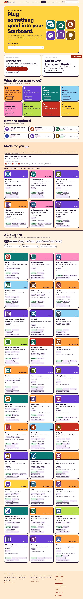

<picture>
  <source media="(prefers-color-scheme: dark)" srcset="assets/logo/stallboard-logo-dark.svg">
  
</picture>

**A storefront for Starboard plug-ins.** Browse them, read what each one can read and change and what it uses, and submit your own. Every plug-in is checked by a robot and read by a person before it is listed, and the listing says who and when.

The site is static: pages built from data in this repository, hosted on GitHub Pages at <https://themightytrex.github.io/stallboard/>. There is no server, no database, no account, no analytics and no request to any other site when a page loads. Every page reads without JavaScript.



## What is in it

- A home page with a slim banner and search, a rail of categories and filters (Works with, the Starboard you have, sort), and every plug-in as a poster card, sortable by memory use.
- A page for each plug-in: what it does, what it can read and change, what it needs (including the Starboard release it needs), **what it uses** (declared limits and measured figures, kept apart), its versions and notes, its help, how to install it and a link to report a problem to its maker.
- **Start here: Starboard**, a page for the platform: its version, how to install it, and which plug-in needs which release.
- **Categories:** a page for each category (and an index of them), linked from the home page, the menu and every plug-in page, with breadcrumbs and a search of its own.
- **Search** on the home page and on each category page: type words, and only plug-ins whose name, summary, category or tags hold every word stay. It runs in the page, needs no library, makes no request and tracks nothing. The count is in a live region.
- **Storefront text** for every plug-in (`data/storefront/<id>.json`): what it does, who it is for, what you will see and what it needs, written from the plug-in's own README and help pages. `python3 tools/open_questions.py` lists what the owner still has to confirm.
- **Pictures**: real screenshots from a test Starboard with made-up data, shown as a gallery on each plug-in page (`assets/shots/<id>/`, alt text in `data/shots.json`). `tools/plugin-shots.sh` takes them; plug-ins with none yet show drawings and say so.
- **Display and accessibility** in the menu of every page (phones included): the design system's own panel with Theme (match device, light, dark), Text size up to 175%, Reduce motion, High contrast, Underline links, Wider text spacing and Remove drop shadows. Choices apply at once and are kept in this browser only (`localStorage` under `stallboard-display`, no cookie); the page works without them. The design system has no colour-blind, style or font choice, so there is none here (Atkinson Hyperlegible Next is used throughout).
- **Measured on a test server**: each plug-in page shows memory (idle after start and after use), processor over 60 seconds and image size from a test Starboard with made-up data, kept apart from figures measured on a real server; category pages sort by it. `tools/measure_plugins.py` takes them (it refuses this computer's own Docker unless told otherwise) and writes `data/resources-test/` and `docs/PLUGIN-MEMORY.md`.
- Submit a plug-in, What Reviewed means, an accessibility statement and a privacy page.
- `catalogue.json`, which Starboard reads (see below).

## Submit a plug-in

1. Open the [Submit a plug-in form](https://github.com/TheMightyTRex/stallboard/issues/new?template=submit-a-plug-in.yml) (or use the Submit page on the site, which opens it with your address filled in).
2. A workflow reads your `starboard-plugin.json` as plain text, runs Starboard's own manifest check and comments with what passed and what to fix. Edit the issue to run it again.
3. A maintainer reviews it with [REVIEWING.md](REVIEWING.md) and adds the label `approved`.
4. A second workflow opens a pull request adding `listings/<id>.json` and its snapshot. A person merges it, and merging deploys the site.

Nothing you submit is ever run. [SECURITY.md](SECURITY.md) says how.

## How Starboard uses its catalogue

In Starboard, open **Settings**, then **Plug-ins**, then **Catalogue**. Under **Catalogue sources**, paste `https://themightytrex.github.io/stallboard/catalogue.json` and select **Add catalogue**. Its plug-ins appear in the Catalogue, each showing what it asks for before you install it. `catalogue.json` has the same schema as the [starboard-plugins](https://github.com/TheMightyTRex/starboard-plugins) catalogue (id, name, description, kind, author, permissions, version, `starboard_api`, manifest address, logo as a small data address, versions and a measured `rest` figure). A test runs Starboard's own `fetch_catalogue` on it.

## How it is built

```
listings/<id>.json        who listed it, who reviewed it, when (one file for each plug-in)
data/snapshots/<id>.json  the plug-in's manifest as fetched and checked, with its logo (refreshed by a script)
data/resources/<id>.json  figures measured on a real server, with date and method
data/starboard-releases.json   each Starboard release and its plug-in API
tools/build.py            writes the whole site into site/ (standard library only, works offline)
```

- **Offline builds.** The build reads only the committed snapshots, so it never fails because a maker's server is down. A listing whose snapshot is older than 14 days, or whose manifest fails Starboard's check, or whose snapshot or logo is broken, is left out of the site, and the build says so in its output and its run summary. The daily refresh opens a pull request only when a file changed, or to move the read date of one not read for 7 days.
- **Refreshing.** `tools/refresh_snapshots.py` and `tools/refresh_releases.py` fetch again (as data, through `tools/lib/safefetch.py`). A daily workflow runs them (and a `starboard-release` or `plugin-release` event, sent by a release workflow with `gh api repos/TheMightyTRex/stallboard/dispatches -f event_type=starboard-release`, runs it at once). It reads with a read-only token that is sent to `api.github.com` only (GitHub limits calls without one), a second job opens one pull request for a person to read, and a third opens an issue if the refresh fails. More permissions than before are shown in bold.
- **The manifest check** is Starboard's own `check()`, copied unchanged into `vendor/starboard/` and pinned to a release (see `VENDORED.json`). It is copied, not downloaded, so a submission check never fetches code and the copy is reviewed in a pull request. To refresh it: `python3 tools/vendor_starboard.py v0.30.0`, run the tests and open a pull request.
- **Resources.** Declared limits come from each manifest. Measured figures come from `tools/measure_resources.py`, run on a Starboard server (it only reads: `docker ps`, `docker stats`, `docker inspect`). Where nothing is measured the page says "Not measured yet". A maker's own figures are shown as "Maker's figures, not measured by the reviewer".

### Run it

```bash
python3 -m unittest discover -s tests   # the tests
python3 tools/build.py                   # builds site/
python3 tools/check_html.py site         # the HTML check
tools/run.sh check                       # accessibility and behaviour checks in the Playwright image (needs Docker)
tools/run.sh shots                       # the screenshots, into reports/
```

`tools/run.sh` uses `mcr.microsoft.com/playwright:v1.63.0-noble`. The checks are axe 4 at WCAG 2.2 AA plus best practice in light, dark, forced colours and at 375 px, a keyboard walk, 175% text, 200% and 400% zoom, 44 px targets, a read without JavaScript and a check that nothing is requested from outside. Zero violations is required.

The owner sets up the labels once with `tools/setup-labels.sh`.

**Test the workflows once.** The submission and approval workflows could not be run for real before the repository had labels and settings. After switching them on, submit a throwaway plug-in and follow "The first real run of the approval workflow" in [REVIEWING.md](REVIEWING.md): the comment and label appear, `approved` from a maintainer opens a pull request, and from anyone else does nothing.

Plug-in files must be at a commit address (a 40 character commit in the raw address), and `catalogue.json` carries each file's SHA-256, so Starboard installs exactly the file that was reviewed. Pages carry a Content-Security-Policy (`default-src 'self'`) set in a meta tag; the host cannot set headers, so `frame-ancestors` is not set.

## Feedback

Every page has the **Send feedback** button, which is [Snaglist](https://github.com/TheMightyTRex/snaglist) (copied unchanged to `assets/snaglist.js`, version 0.6.0). A report opens an issue here with the label `feedback`. The [privacy page](https://themightytrex.github.io/stallboard/privacy.html) says what a report holds and never holds.

## Licence

MIT. See [LICENSE](LICENSE). Third-party files: the design system's CSS and script and the Atkinson Hyperlegible Next font (SIL OFL, `assets/ds/fonts/LICENSE-OFL.txt`), Snaglist (MIT), axe-core (MPL 2.0, used only to test) and a copy of some Starboard modules (MIT, `vendor/starboard/LICENSE`).
